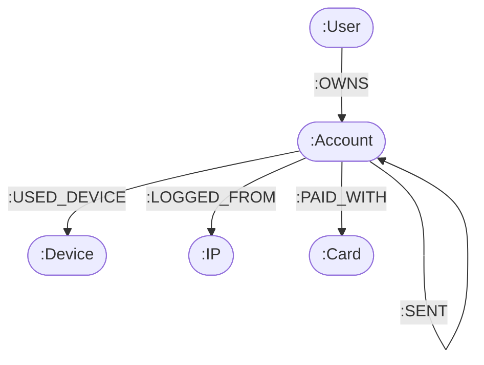

# FraudGraph: Graph-Based Financial Crime & Syndicate Detection Platform

[](LICENSE)
[](https://www.python.org/)
[](https://neo4j.com/)
[](https://nextjs.org/)
[](https://fastapi.tiangolo.com/)

FraudGraph is a full-stack forensic intelligence platform designed to detect organized fraud rings, synthetic identities, and money laundering corridors across banking networks. 

Unlike traditional relational anti-fraud rules that inspect single accounts in isolation, FraudGraph evaluates **relationship topologies**—connecting shared physical hardware, rotating proxy IPs, circular transaction chains, and rapid capital dissipation.

---

## The Core Problem: Why Relational Databases Fail on Fraud Rings

Organized fraud syndicates do not act like typical individual fraudsters. They distribute activity across dozens of burner accounts to keep single-account metrics looking normal. The signal is entirely in the **graph topology**:
* 20 different accounts logging in from the same device canvas hash within 48 hours.
* Capital traveling in a circle ($A \to B \to C \to D \to A$) within 72 hours to layer stolen funds.
* A "mule" account receiving 8 rapid deposits and immediately routing 95% out to crypto cash-out sinks.

### The Computational Bottleneck
In an RDBMS like PostgreSQL or MySQL, finding a 5-hop cycle requires joining the `transactions` table against itself 5 times:

```sql
-- PostgreSQL recursive CTE: exponential join explosion O(N^d)
WITH RECURSIVE transfer_cycles AS (
  SELECT from_account_id, to_account_id, amount, ts, 1 as depth, ARRAY[from_account_id] as visited
  FROM transactions
  UNION ALL
  SELECT t.from_account_id, t.to_account_id, t.amount, t.ts, tc.depth + 1, tc.visited || t.from_account_id
  FROM transactions t
  JOIN transfer_cycles tc ON t.from_account_id = tc.to_account_id
  WHERE tc.depth < 6 AND NOT (t.from_account_id = ANY(tc.visited))
)
SELECT * FROM transfer_cycles WHERE to_account_id = visited[1];
```

As the transaction table grows, this query degrades exponentially: **$O(N^d)$**. In our benchmarks on just 20,236 transactions, PostgreSQL takes over **8,000 ms** to identify circular loops.

### The Neo4j Graph Solution: Index-Free Adjacency
Neo4j does not use joins. Every account node in the storage engine holds direct 64-bit physical memory pointers to its incoming and outgoing relationships. Traversing an edge is a pointer dereference: **$O(1)$**. 

The same cycle detection in Neo4j runs in **231 ms**—an empirical **34.6x speedup**.

---

## System Architecture

```
┌─────────────────────────────────────────────────────────────────────────────┐
│                       FraudGraph System Architecture                        │
├─────────────────────────────────────────────────────────────────────────────┤
│                                                                             │
│   Next.js 14 Frontend (:3001)                FastAPI Backend (:8008)       │
│   ┌───────────────────────────────┐          ┌───────────────────────────┐  │
│   │ • Executive Dashboard (KPIs)  │  REST    │ • Pattern Detectors       │  │
│   │ • React Flow Canvas (@xyflow) │◄────────►│ • GDS Orchestrator        │  │
│   │ • Accounts & Transfers Ledger │   JWT    │ • Risk Scoring Engine     │  │
│   │ • Syndicate Ring Registry     │          │ • Auth & Audit Controls   │  │
│   └───────────────────────────────┘          └─────────────┬─────────────┘  │
│                                                            │                │
│                         Bolt Protocol (:7687)              │ SQL (:5433)    │
│                         ▼                                  ▼                │
│   ┌────────────────────────────────────────┐ ┌───────────────────────────┐  │
│   │ Neo4j 5 Community Edition (with GDS)   │ │ PostgreSQL 16 Alpine      │  │
│   │ • 5,000 Accounts | 20,236 Transfers   │ │ • Baseline Benchmark DB   │  │
│   │ • Louvain, PageRank & Centrality       │ │ • Relational Comparison   │  │
│   └────────────────────────────────────────┘ └───────────────────────────┘  │
└─────────────────────────────────────────────────────────────────────────────┘
```

---

## Data Model (Labeled Property Graph)

Financial transactions are modeled as direct directed edges:
`(:Account)-[:SENT {txn_id, amount, ts}]->(:Account)`



### Why Transactions are Edges (Not Nodes)
1. **Halves Path Length:** Finding a 4-hop cycle with direct edges requires traversing 4 relationships (`-[:SENT*3..6]->`). If transactions were nodes (`Account -> Txn -> Account`), that same query requires 8 hops, quadrupling the combinatorial search space.
2. **Pagecache Efficiency:** Avoids loading 20,000+ intermediate transaction node records into Neo4j's pagecache memory.
3. **Graph Data Science (GDS) Alignment:** Allows projecting a monopartite account graph directly into memory for PageRank and Louvain without complex bipartite projections.

---

## The 3 Fraud Ring Typologies

### 1. Pattern P1: Shared-Device & Shared-IP Rings (Device Farms)
Fraud syndicates operate automated account emulators or physical device farms where dozens of accounts share the same browser canvas fingerprint or residential IP.

```cypher
MATCH (a:Account)-[ud:USED_DEVICE]->(d:Device)
WITH d, collect(DISTINCT a) AS accounts, count(DISTINCT a) AS account_count
WHERE account_count >= $min_accounts
UNWIND accounts AS acc
OPTIONAL MATCH (acc)-[lf:LOGGED_FROM]->(ip:IP)
WITH d, accounts, account_count, collect(DISTINCT ip.id) AS shared_ips
RETURN d.id AS device_id, d.os AS os, account_count AS size,
       [acc IN accounts | acc.id] AS member_account_ids, shared_ips
ORDER BY account_count DESC
```

### 2. Pattern P2: Circular Money Flows (Layering Cycles $\le 72$h)
Funds move in a closed loop ($A \to B \to C \to A$) within a 72-hour window to create fake transaction history and disguise illicit origin.

**Combinatorial Guards:**
* **Path Capping:** Bounded to `*3..6` hops to prevent $O(V!)$ traversal explosions.
* **Symmetry Breaking:** `ALL(n IN nodes(path)[1..-1] WHERE n.id > start.id)` ensures each cycle is traversed only from its lexicographically smallest node ID, eliminating duplicate rotated permutations.
* **Monotonic Time:** `datetime(txns[i].ts) <= datetime(txns[i+1].ts)` requires money to move forward in time.

### 3. Pattern P3: Money Mule Funnels (Fan-In $\to$ Fan-Out)
Aggregates stolen deposits from $\ge 5$ distinct victim accounts and routes $\ge 80\%$ out to 1–2 cash-out sinks within a 24-hour dwell window.

---

## Graph Data Science (GDS) & Explainable Risk Scoring

Beyond pattern matching, FraudGraph projects the graph in-memory using **Neo4j GDS**:
1. **Louvain Modularity:** Discovers hidden communities that don't share obvious direct links.
2. **PageRank Centrality:** Pinpoints master accumulator accounts (capital sinks).
3. **Betweenness Centrality:** Highlights bridge accounts that funnel funds between disparate syndicates.

### Explainable Risk Scoring Formula
Every account risk score ($0.0 \text{ to } 100.0$) is calculated with 100% regulatory explainability:

$$\text{Score}(a) = \min\Big(100.0, \; 25 \cdot \mathbb{I}_{P1} + 35 \cdot \mathbb{I}_{P2} + 30 \cdot \mathbb{I}_{P3} + 15 \cdot \text{PR}_{\text{norm}} + 15 \cdot \text{BC}_{\text{norm}}\Big)$$

Every score mutation writes an audit trail to `Account.risk_reasons` (e.g., `["SHARED_DEVICE_RING: dev_001", "CIRCULAR_FLOW_MEMBER: 4-hop", "HIGH_PAGERANK_SINK: 0.89"]`).

---

## Detection Accuracy Benchmarks

Evaluated against the ground-truth synthetic banking topology using `scripts/evaluate_accuracy.py`:

| Pattern | Typology | Ground Truth | Detected | True Positives | Precision | Recall | F1 Score |
|---|---|:---:|:---:|:---:|:---:|:---:|:---:|
| **P1** | Shared-Device Rings | 15 | 15 | 15 | **100.0%** | **100.0%** | **100.0%** |
| **P2** | Circular Money Flows | 10 | 10 | 10 | **100.0%** | **100.0%** | **100.0%** |
| **P3** | Mule Accounts | 8 | 8 | 8 | **100.0%** | **100.0%** | **100.0%** |

---

## Quickstart (One Command via Docker Compose)

The entire platform—Neo4j 5 with GDS, PostgreSQL, FastAPI backend, and Next.js frontend—spins up and auto-seeds with a single command:

```bash
docker compose up -d
```

Once running:
* **Analyst Dashboard:** [http://localhost:3001](http://localhost:3001)
* **Backend API Documentation (Swagger):** [http://localhost:8008/docs](http://localhost:8008/docs)
* **Neo4j Browser:** [http://localhost:7474](http://localhost:7474) (`bolt://localhost:7687`)

### Default Viva & Demo Credentials
| Role | Username | Password |
|---|---|---|
| **Analyst** | `analyst` | `analystpassword123` |
| **Administrator** | `admin` | `adminpassword123` |

*(The UI also includes 1-click login buttons on `/login` and `/admin` for rapid demoing).*

---

## Local Development Setup (Manual)

If running without Docker:

### 1. Prerequisites
* Python 3.11+
* Node.js 18+
* Neo4j 5 Community Edition with GDS plugin running locally on `bolt://localhost:7687`

### 2. Backend Setup
```bash
# Clone the repository
git clone https://github.com/Aayush217/frauddetection.git
cd frauddetection

# Set up Python virtual environment
python -m venv .venv
# On Windows:
.venv\Scripts\activate
# On Linux/macOS:
source .venv/bin/activate

# Install dependencies
pip install -r backend/requirements.txt

# Generate synthetic dataset (5,000 accounts, 20,236 transactions)
python scripts/generate_data.py --scale 1.0 --seed 42

# Start the FastAPI server
export PYTHONPATH=backend
uvicorn app.main:app --host 0.0.0.0 --port 8008 --reload
```

### 3. Frontend Setup
```bash
cd frontend_clean
npm install --legacy-peer-deps
npm run build
npm run start -p 3001
```

---

## Verification & Automated Test Suite

Run the full automated test suite (CRUD, cycle detection, and risk scoring):

```bash
pytest tests/ -v
```

Run the empirical accuracy evaluation script:

```bash
python scripts/evaluate_accuracy.py
```

---

## Project Structure

```
frauddetection/
├── backend/
│   ├── app/
│   │   ├── api/            # REST API endpoints (accounts, transfers, rings, detect, admin)
│   │   ├── core/           # Security, JWT auth, logging middleware, configuration
│   │   ├── db/             # Neo4j driver, schema constraints, connection pooling
│   │   ├── models/         # Pydantic v2 schemas and validation models
│   │   ├── services/       # Cypher detection algorithms and GDS pipeline orchestrator
│   │   └── main.py         # FastAPI application entrypoint with auto-seeding lifespan
│   ├── requirements.txt    # Python dependencies
│   └── Dockerfile          # Backend container specification
├── frontend_clean/         # Next.js 14 App Router application
│   ├── src/
│   │   ├── app/            # 10 pages: /, /login, /accounts, /transfers, /rings, /investigate, ...
│   │   ├── components/     # Shell, navigation, custom React Flow canvas node renderers
│   │   └── lib/            # Type-safe API client and auth state management
│   ├── tailwind.config.ts  # Executive light theme design tokens
│   └── Dockerfile          # Next.js container specification
├── docs/                   # Academic evaluation reports, data models, and viva defense guides
├── scripts/                # Synthetic data generator & accuracy evaluator
├── tests/                  # Pytest automated test suite
└── docker-compose.yml      # Orchestration for Neo4j, Postgres, Backend, and Frontend
```

---

