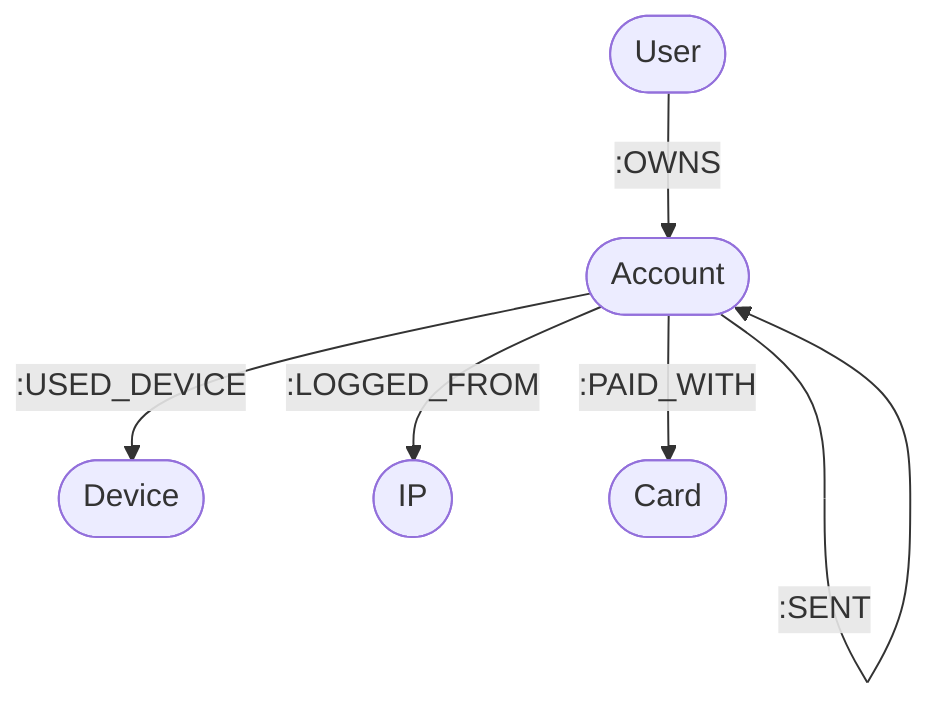

# FraudGraph Data Model

## 1. Overview
FraudGraph is modeled as a property graph in Neo4j 5 Community Edition. The graph structure captures identity resolutions, shared access vectors, payment instruments, and capital velocity across accounts.



---

## 2. Node Schemas

Each node has a globally unique `id` enforced via database uniqueness constraints. All Personally Identifiable Information (PII) is cryptographically hashed (SHA-256) prior to storage.

### `User`
Represents the human legal entity associated with one or more banking accounts.
* `id` (`String`, Unique): Unique user identifier (e.g., `usr_a1b2c3d4`).
* `name` (`String`): Anonymized/synthetic display name.
* `email_hash` (`String`): SHA-256 hash of email address.
* `created_at` (`String` ISO 8601): User profile creation timestamp.

### `Account`
Represents a financial account (e.g., checking, wallet) that holds balance and initiates transfers.
* `id` (`String`, Unique): Account identifier (e.g., `acc_1001`).
* `status` (`String`): `active`, `suspended`, `frozen`, or `closed`.
* `opened_at` (`String` ISO 8601): Account opening timestamp.
* `risk_score` (`Float`): Fraud risk score from `0.0` to `100.0` (indexed).
* `risk_reasons` (`List[String]`): Explainable audit trail of risk drivers.
* `review_state` (`String`): `unreviewed`, `under_review`, `confirmed`, `false_positive` (indexed).

### `Device`
Represents physical hardware used to access accounts.
* `id` (`String`, Unique): Device identifier (e.g., `dev_8891`).
* `fingerprint_hash` (`String`): SHA-256 hash of browser/hardware canvas fingerprint.
* `os` (`String`): Operating system (e.g., `iOS`, `Android`, `Windows`, `macOS`).
* `first_seen` (`String` ISO 8601): Timestamp when device was first observed.

### `IP`
Represents an IP address observed during logins or sessions.
* `id` (`String`, Unique): IP entity identifier (e.g., `ip_5012`).
* `address_hash` (`String`): SHA-256 hash of IP address.
* `country` (`String`): Two-letter ISO country code (e.g., `US`, `DE`, `GB`).

### `Card`
Represents a debit or credit card linked to an account.
* `id` (`String`, Unique): Card identifier (e.g., `crd_4412`).
* `last4` (`String`): Last 4 digits of card number (e.g., `4821`).
* `issuer` (`String`): Card issuer / brand (e.g., `Visa`, `Mastercard`, `Amex`).

---

## 3. Relationship Schemas

### `(User)-[:OWNS]->(Account)`
Represents legal ownership of an account by a user. A user may own multiple accounts.

### `(Account)-[:USED_DEVICE]->(Device)`
Records hardware device interactions.
* `first_seen` (`String` ISO 8601): Earliest session timestamp.
* `last_seen` (`String` ISO 8601): Most recent session timestamp.

### `(Account)-[:LOGGED_FROM]->(IP)`
Records network IP address access.
* `count` (`Integer`): Frequency of logins/sessions from this IP.
* `last_seen` (`String` ISO 8601): Most recent session timestamp.

### `(Account)-[:PAID_WITH]->(Card)`
Links account to a stored card payment instrument.

### `(Account)-[:SENT]->(Account)`
Represents direct financial transfers between two accounts.
* `txn_id` (`String`): Unique transaction identifier (e.g., `txn_991823`).
* `amount` (`Float`): Monetary value transferred (indexed).
* `ts` (`String` ISO 8601): Transaction timestamp (indexed).

---

## 4. Architectural Decision: Transactions as Edges vs Nodes

### Design Decision
In FraudGraph, financial transactions are modeled as direct directed edges:
`(:Account)-[:SENT {txn_id, amount, ts}]->(:Account)`
rather than intermediate transaction nodes `(:Account)-[:OUT]->(:Transaction)-[:IN]->(:Account)`.

### Rationale
1. **Simpler Traversal & Cypher Expressiveness**:
   Detecting multi-hop circular flows and money laundering trails reduces to natural path patterns:
   ```cypher
   MATCH path = (a:Account)-[:SENT*3..6]->(a:Account)
   ```
   If transactions were nodes, every transfer step requires traversing two relationships (`Account -> Transaction -> Account`), doubling path lengths and complicating Cypher path expressions, variable-length path syntax, and GDS graph projections.
2. **Lower Storage Overhead & Higher Cache Locality**:
   Treating transactions as edges avoids creating tens of thousands of intermediate node records, node label indices, and relationship overhead in Neo4j's pagecache.
3. **Graph Data Science (GDS) Alignment**:
   Algorithms like PageRank, Betweenness Centrality, and Louvain community detection operate naturally on monopartite Account-to-Account directed graphs where edge weights correspond to transfer amounts.

### Tradeoff & Mitigations
* **Tradeoff**: Multi-party or complex split transactions (1-to-many or many-to-many) cannot be captured natively by a single binary edge.
* **Tradeoff**: If millions of repeated transfers occur between the exact same pair of accounts, multiple parallel edges are created.
* **Mitigation**: In retail banking and P2P wire transfers, transactions are intrinsically point-to-point (one sender, one recipient). Relationship property indexing in Neo4j 5 (`SENT.ts`, `SENT.amount`) allows efficient temporal and amount filtering directly on edges.

---

## 5. Constraints & Indexes

```cypher
// Uniqueness Constraints
CREATE CONSTRAINT user_id_unique IF NOT EXISTS FOR (u:User) REQUIRE u.id IS UNIQUE;
CREATE CONSTRAINT account_id_unique IF NOT EXISTS FOR (a:Account) REQUIRE a.id IS UNIQUE;
CREATE CONSTRAINT device_id_unique IF NOT EXISTS FOR (d:Device) REQUIRE d.id IS UNIQUE;
CREATE CONSTRAINT ip_id_unique IF NOT EXISTS FOR (i:IP) REQUIRE i.id IS UNIQUE;
CREATE CONSTRAINT card_id_unique IF NOT EXISTS FOR (c:Card) REQUIRE c.id IS UNIQUE;

// Node Property Indexes
CREATE INDEX account_risk_score_idx IF NOT EXISTS FOR (a:Account) ON (a.risk_score);
CREATE INDEX account_review_state_idx IF NOT EXISTS FOR (a:Account) ON (a.review_state);

// Relationship Property Indexes (Neo4j 5)
CREATE INDEX sent_ts_idx IF NOT EXISTS FOR ()-[r:SENT]-() ON (r.ts);
CREATE INDEX sent_amount_idx IF NOT EXISTS FOR ()-[r:SENT]-() ON (r.amount);
```
